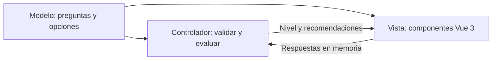

# NovaShield: modulo de autodiagnostico con Vue 3 y MVC

## Alcance academico

Se incorpora una pagina independiente, `novashield-app/page/diagnostico.html`,
accesible mediante el boton **Autodiagnostico gratuito** de la portada.
Las paginas existentes continuan usando HTML, CSS, JavaScript Vanilla y Firebase.
No se migra la aplicacion completa ni se modifican sus permisos o autenticacion.

El modulo es publico, no requiere registro y no solicita informacion personal.
Solo utiliza respuestas cerradas en memoria; no guarda respuestas, no las envia
a un servidor y no inicia Firebase. Recargar o reiniciar limpia el cuestionario.
El pie de pagina se obtiene de un archivo HTML publico del propio proyecto.

## Arquitectura MVC

| Responsabilidad | Archivo | Implementacion |
|---|---|---|
| Modelo | `assets/js/diagnostico/model.js` | Siete preguntas, opciones, puntuaciones y niveles inmutables. Sin Vue, DOM o Firebase. |
| Controlador | `assets/js/diagnostico/controller.js` | Valida completitud y opciones, calcula el indice y selecciona recomendaciones. Funciones puras, sin persistencia. |
| Vista | `page/diagnostico.html` y `assets/js/diagnostico/view.js` | Plantilla Vue y componentes PreguntaDiagnostico y ResultadoDiagnostico; muestran datos y delegan la evaluacion. |
| Composicion publica | `assets/js/diagnostico/app.js` | Montaje, mensaje de error, menu movil y pie publico. No importa el layout que inicializa Firebase. |

Es una separacion MVC del lado del cliente. Vue aporta enlaces reactivos a la
vista; no se presenta como una migracion de la arquitectura completa del sistema.



## Uso real de Vue 3

La vista importa la distribucion oficial de produccion **Vue 3.5.43** desde
`assets/vendor/vue-3.5.43.esm-browser.prod.js`; su licencia MIT esta incluida.
La copia local evita depender de un CDN de Vue durante la visita. No se necesita
Vite ni una compilacion para servir esta pagina con un servidor HTTP estatico.

- `createApp` monta la interfaz.
- `reactive` conserva las respuestas efimeras; `ref` conserva resultado y errores.
- `computed` actualiza el progreso y el enlace de cada componente de pregunta.
- `v-for` genera preguntas, opciones y recomendaciones.
- `v-model`, props y el evento `update:modelValue` enlazan los componentes.
- `v-if` muestra errores y resultados; `:class` destaca seleccion y nivel.
- `@submit.prevent` calcula sin enviar el formulario; `@click` reinicia.
- `nextTick` permite enfocar el primer campo incompleto o el resultado montado.

No se usa `v-html` para datos del cuestionario. Vue escapa las interpolaciones
de texto. Las clases CSS del resultado se definen en la vista, no en el modelo.

## Preguntas y criterio de evaluacion

Temas: contrasenas, autenticacion multifactor, respaldos separados, restauracion,
phishing, actualizaciones y acceso a datos.

| Respuesta | Puntos |
|---|---:|
| Si, de forma habitual | 0 |
| En parte | 1 |
| No | 2 |
| No lo se | 2 |

El indice educativo suma entre **0 y 14** puntos: **baja 0-3**, **moderada 4-8**
y **alta 9-14**. Son umbrales definidos para este proyecto academico, no una
escala estadisticamente validada ni una probabilidad de ataque.

No se calcula ningun nivel con respuestas incompletas. Se rechazan valores y
preguntas desconocidos. Las recomendaciones corresponden a practicas ausentes,
parciales o desconocidas; las de dos puntos aparecen primero. Las respuestas
desconocidas se identifican expresamente como incertidumbre. Si todas son
positivas, se recomienda mantener y comprobar las practicas periodicamente.

El aviso permanece visible: **el resultado es orientativo y no sustituye una
auditoria profesional**. No se examinan equipos, cuentas ni vulnerabilidades.

Referencias de las practicas: [CISA, esenciales de ciberseguridad](https://www.cisa.gov/resources-tools/resources/four-cybersecurity-essentials-sltts),
[CISA, autenticacion multifactor](https://www.cisa.gov/audiences/small-and-medium-businesses/secure-your-business/require-multifactor-authentication)
y [NCSC, respaldo de datos para organizaciones pequenas](https://www.ncsc.gov.uk/collection/small-organisations-guide-to-cyber-security/backing-up-your-data).
Estas referencias no avalan los umbrales del cuestionario.

## Verificacion y ejecucion local

Pruebas desde `tests/` con Node.js 24 o posterior:

```powershell
npm.cmd ci --ignore-scripts
npm.cmd test
```

**37 pruebas aprobadas, 0 fallidas**: 27 pruebas de modelo/controlador y 10 de
interfaz. Una prueba recorre las **16384 combinaciones** de respuestas. La vista
se monta con **Vue real** en jsdom; se verifican componentes, radios, progreso,
validacion, niveles, recomendaciones, edicion, reinicio, privacidad y menu movil.
No se simula la biblioteca Vue ni se realizan llamadas a Firebase.

Para inspeccion visual, desde la raiz del espacio de trabajo:

```powershell
node tests/serve-diagnostico.mjs
```

Abrir `http://127.0.0.1:4317/page/diagnostico.html`. Este servidor de pruebas
solo sirve los recursos del diagnostico; bloquea las otras paginas para evitar
inicializar accidentalmente Firebase. Los enlaces de esas paginas se comprueban
como rutas de archivos, no navegando hacia el Firebase real.

No hubo navegador conectado disponible para inspeccion visual automatizada.
Antes de publicar, revisar en un navegador real escritorio y movil (320, 390
y 768 px), teclado, foco y mensajes. Confirmar que se sirvan los modulos JS con
MIME correcto y que los archivos de Vue y su licencia esten presentes.
Si existe una CSP que prohíba compilacion de plantillas en tiempo de ejecucion,
precompilar las plantillas en lugar de relajar la politica.

Los estilos particulares estan en `assets/css/diagnostico.css`; se reutilizan
colores, tipografia, botones y puntos de adaptacion de NovaShield. Las pruebas
y esta documentacion estan fuera de la carpeta publicada de la aplicacion.
No se ejecuto Deploy ni se modificaron reglas de Firestore o Authentication.
